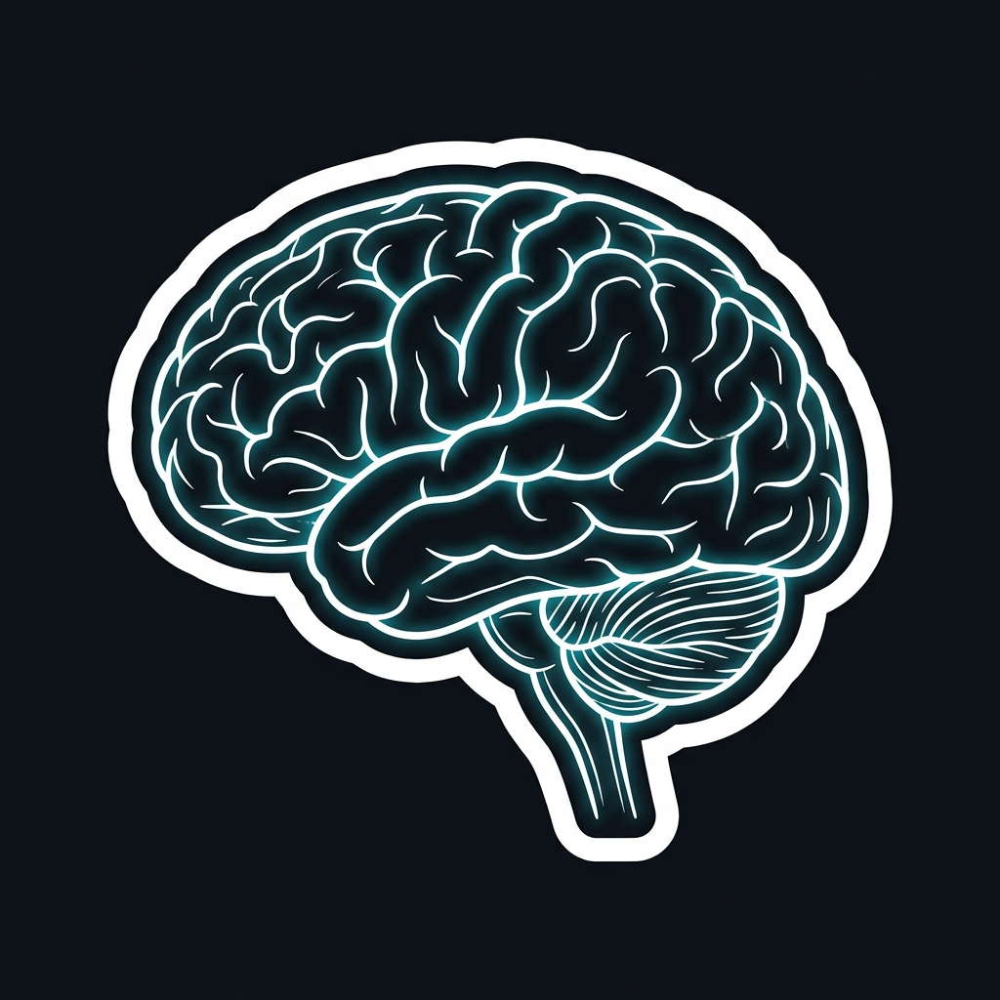
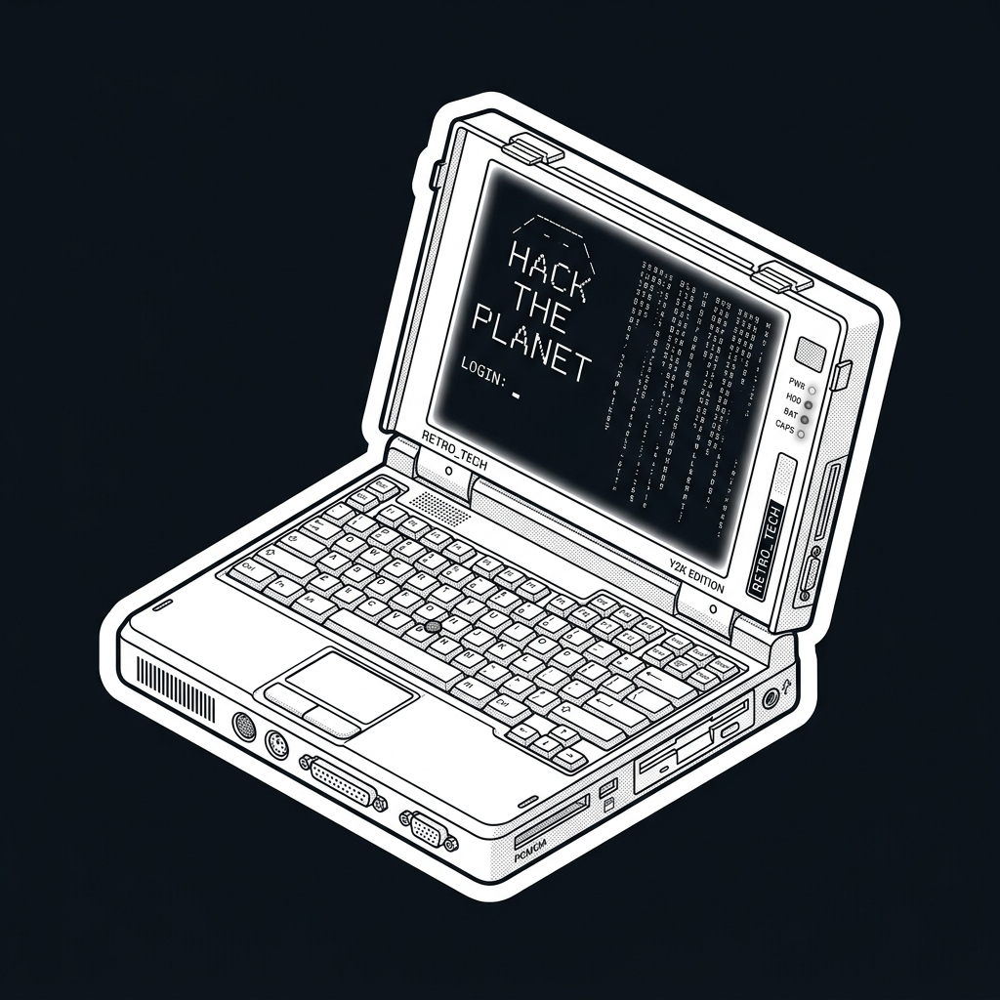

  

<h1 align="center">Namaste 👋 I'm Aditya</h1>

  <b>B.Tech AI & ML Undergrad • Software Developer • Lead Graphic Designer</b>

  
  
  

---

### 🔗 Know About Me

<table>
  <tr>
    <td width="28%" align="center" valign="middle">
      
    </td>
    <td width="72%" valign="top">
      <h4>Hey there! I'm Aditya</h4>
      

        I'm an <b>AI & Machine Learning undergraduate</b> diving deep into scalable software development, neural intelligence, and high-craft digital experiences.
      

      

        By day, I'm mastering data structures and algorithms, building full-stack web applications, and experimenting with predictive pipelines in <b>Python, C++, and Modern JavaScript</b>.
      

      

        When I'm not tuning loss curves or shipping code, you can usually find me directing commercial visual campaigns at <b>Suyash Graphics</b>, exploring tech podcasts, or turning pages of <i>Atomic Habits</i> and <i>Ikigai</i>.
      

      

        <b>⚙ Tech Stack:</b> 
        
        
        
        
        
        
        
        
      

    </td>
  </tr>
</table>

---

### 🔗 Top Projects (built to avoid manual labor)

<table>
  <tr>
    <td width="72%" valign="top">
      <ul>
        <li>
          <a href="https://aadi-x.github.io/portfolio/"><b>PORTFOLIO & LIVE LABS</b></a> — Production portfolio engineered with custom physics cursor engines, responsive aesthetics, and zero-dependency speed.
        </li>
         
        <li>
          <a href="https://aadi-x.github.io/habit-studio/"><b>HABIT TRACKER STUDIO</b></a> — Focused habit-building interface with completion rings and streak metrics, because discipline consistently beats motivation.
        </li>
         
        <li>
          <a href="https://aadi-x.github.io/rocnet-game/"><b>ROCNET SURVIVAL ARCADE</b></a> — Interactive 60fps retro space shooter survival game built purely for fun, adrenaline, and dodging floating geometry.
        </li>
         
        <li>
          <a href="https://github.com/aadi-x/CodeAlpha-AI-Internship"><b>AI & NLP CLASSIFICATION PIPELINE</b></a> — Machine learning classification and NLP scripts running on real-world datasets, caffeine, and precision feature engineering.
        </li>
         
        <li>
          <a href="https://www.behance.net/gallery/246357931/Portfolio-Graphics-Design-Aditya-Walvekar"><b>SUYASH GRAPHICS SUITE</b></a> — Commercial visual branding, product visualization, and marketing campaigns for 100+ production clients.
        </li>
      </ul>
    </td>
    <td width="28%" align="center" valign="middle">
      
    </td>
  </tr>
</table>

---

### 🔗 Connect

  
  
  
  
  
  

<blockquote>
  

    <em>Code is never finished. It only becomes slightly less terrible over time.</em>
  

  

    <em>Every commit I make is essentially just a small, desperate apology to my future self. Someday I will return to this codebase, look at the spaghetti I've written, and wonder who let me anywhere near a keyboard.</em>
  

</blockquote>

---

### 🔗 Contribution

  

  
  

---

  <samp>Crafted with precision &amp; caffeine • © 2026 Aditya Walvekar</samp>

